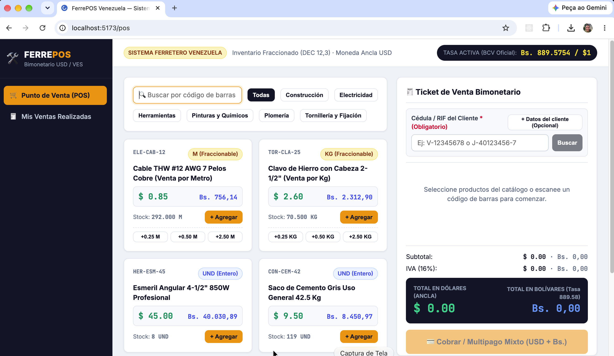
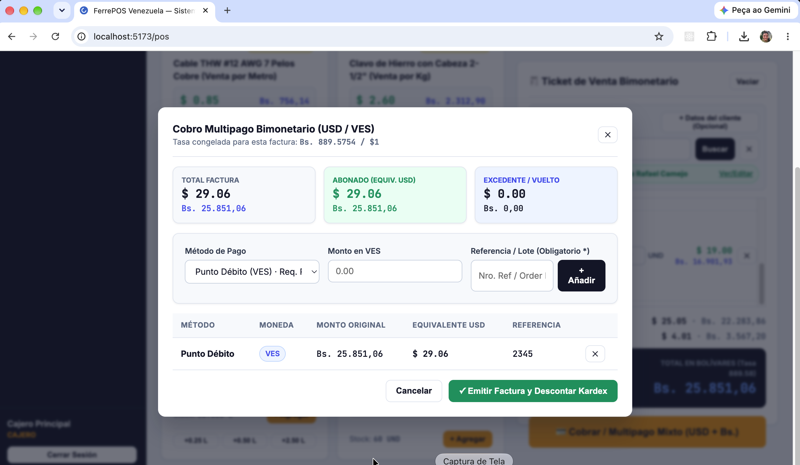
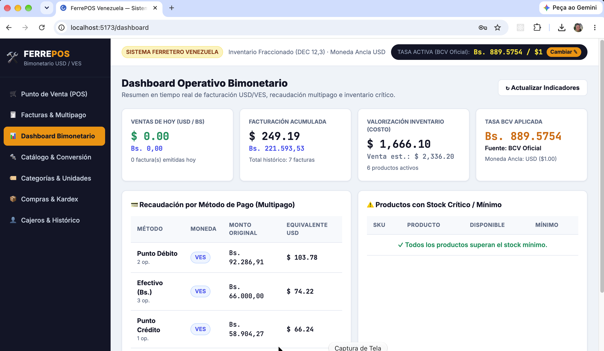
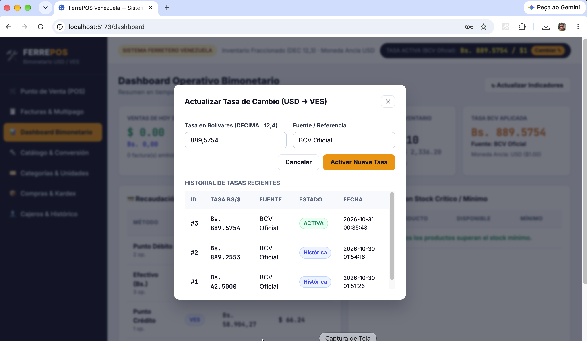
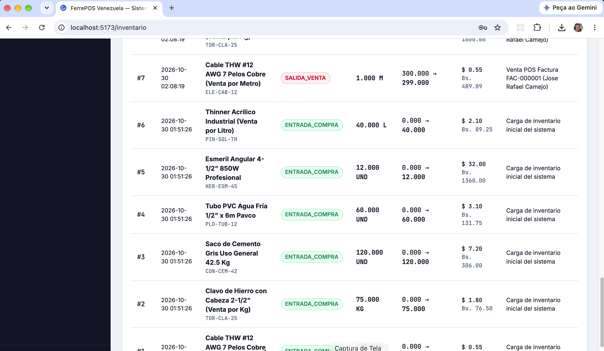

# FerrePOS - Sistema POS, Inventario Fraccionado y Facturación Bimonetaria (USD / VES)

Sistema integral de Punto de Venta (POS), control de inventario con soporte de unidades fraccionadas y facturación bimonetaria (Dólares USD y Bolívares VES) diseñado para ferreterías en Venezuela. El proyecto implementa una arquitectura desacoplada conformada por un Backend RESTful API en CodeIgniter 4, base de datos relacional en MySQL 8.0 y un Frontend SPA en Vue 3, todo orquestado mediante Docker Compose.

> Para consultar la guía detallada de operación paso a paso (cobro bimonetario, inventario fraccionado, arqueos y kardex), revise el [Manual de Usuario](file:///Users/joserafaelcamejo/Codigos/ferre_pos/docs/MANUAL_DE_USUARIO.md).

## Arquitectura y Stack Tecnológico

1. **Separación Estricta**:
   - Backend y Frontend operan de forma independiente comunicándose exclusivamente mediante JSON sobre HTTP REST.
2. **Backend (`ferre_pos_api` - CodeIgniter 4 / PHP 8.5-FPM)**:
   - Controladores RESTful basados en `ResourceController` y `ResponseTrait`.
   - Autenticación stateless mediante tokens JWT (HS256) a través de filtro dedicado (`JwtAuthFilter`) y soporte CORS (`CorsFilter`).
   - Estandarización de respuestas JSON con la estructura `{"status": 200, "error": null, "messages": "...", "data": {...}}`.
   - Gestión de esquema y datos iniciales mediante Migraciones y Seeders de CodeIgniter 4.
3. **Base de Datos (MySQL 8.0 / InnoDB)**:
   - Prohibición estricta de tipos `FLOAT` o `DOUBLE` para evitar errores de redondeo.
   - Montos monetarios (`costo_usd`, `precio_venta_usd`, subtotales, impuestos y totales): `DECIMAL(14,2)`.
   - Tasas de cambio (`tasa_ves`, `tasa_aplicada`): `DECIMAL(12,4)`.
   - Cantidades e inventario (`stock_actual`, `stock_minimo`, `factor_conversion`, `cantidad`): `DECIMAL(12,3)` para soportar ventas fraccionadas (metros, kilogramos, litros).
   - Transacciones ACID (`$db->transStart()` / `$db->transComplete()`) con bloqueo pesimista (`FOR UPDATE`) en operaciones de inventario, compras, ajustes y ventas.
4. **Frontend (`ferre_pos_web` - Vue 3 + Vite)**:
   - Vue 3 con Composition API (`<script setup>`), Pinia para gestión de estado reactivo, Vue Router y Axios.
   - Visualización simultánea de precios, subtotales, impuestos, pagos mixtos y vueltos en USD y VES calculados en tiempo real según la tasa de cambio activa.

## Reglas de Negocio Principales

### 1. Gestión Bimonetaria (USD / VES)
- **Moneda ancla**: Dólar estadounidense (USD).
- Las compras o entradas de inventario pueden registrarse en USD o en VES, almacenando siempre el costo convertido a USD y congelando la tasa de cambio aplicada en el documento.
- El precio en Bolívares se calcula dinámicamente (`precio_venta_usd * tasa_activa`) en el POS, y cada factura emitida congela los montos en ambas monedas junto con el `tasa_cambio_id` y la `tasa_aplicada` del momento exacto de la transacción.

### 2. Categorías, Unidades de Medida y Factor de Conversión
- Catálogo de categorías de ferretería (Electricidad, Plomería, Tornillería y Fijación, Construcción, Herramientas, Pinturas y Químicos).
- Catálogo de unidades de medida (`UND`, `M`, `KG`, `L`, `CAJA`, `ROLLO`) con el indicador booleano `permite_decimales`.
- Soporte de `factor_conversion` en productos para transformar automáticamente las unidades de compra a unidades de venta al registrar facturas de proveedor (por ejemplo, compra de 1 `ROLLO` equivalente a `100.000 M` para la venta al detal por metro).

### 3. Kardex Inmutable
- Ninguna existencia en `productos.stock_actual` se modifica directamente sin generar un registro auditable en la tabla `movimientos_inventario`.
- Tipos de movimiento soportados:
  - `ENTRADA_COMPRA`
  - `SALIDA_VENTA`
  - `ANULACION_VENTA`
  - `AJUSTE_POSITIVO`
  - `AJUSTE_NEGATIVO`

### 4. Facturación y Multipago Mixto (`venta_pagos`)
- Métodos de pago preconfigurados:
  - `EFECTIVO_VES` (VES - sin referencia obligatoria)
  - `EFECTIVO_USD` (USD - sin referencia obligatoria)
  - `PUNTO_DEBITO` (VES - requiere referencia/lote)
  - `PUNTO_CREDITO` (VES - requiere referencia/lote)
  - `BINANCE` (USD - requiere referencia/Order ID)
  - `ZELLE` (USD - requiere referencia)
  - `PAGO_MOVIL` (VES - requiere referencia)
- Una misma factura admite múltiples pagos combinando USD y VES, calculando el monto equivalente en USD de cada abono y registrando el vuelto entregado en USD y/o VES.

## Capturas de Pantalla e Interfaz del Sistema

### 1. Punto de Venta (POS) Bimonetario
Interfaz ágil de caja y mostrador diseñada para ventas rápidas con doble visualización de precios (USD y VES) calculados en tiempo real según la tasa activa. Incluye botones de fraccionamiento rápido para artículos vendidos por metro o kilogramo (`+0.25`, `+0.50`, `+2.50`), filtrado por categorías y ticket de venta interactivo.



---

### 2. Cobro Multipago Mixto (USD / VES) y Vueltos
Modal de liquidación que congela la tasa de cambio de la factura. Permite combinar múltiples métodos de pago (Efectivo USD/VES, Punto Débito, Punto Crédito, Pago Móvil, Zelle, Binance) en una sola transacción, calculando equivalencias en dólares y saldos de vuelto o excedente en tiempo real.



---

### 3. Dashboard Operativo Bimonetario
Panel de control con métricas en tiempo real: ventas del día en USD y VES, facturación acumulada, valorización total del inventario al costo, tasa de cambio BCV aplicada, recaudación desglosada por método de pago y panel de alertas de productos en stock mínimo.



---

### 4. Actualización y Registro Histórico de Tasa de Cambio
Ventana de control de la Tasa Oficial BCV activa que rige todo el sistema. Mantiene un registro histórico auditable de cada tasa fijada con fecha, hora exacta y el usuario que realizó la actualización.



---

### 5. Kardex Inmutable y Trazabilidad de Inventario
Consulta detallada de todos los movimientos de stock (`ENTRADA_COMPRA`, `SALIDA_VENTA`, ajustes) con precisión de 3 decimales para unidades fraccionadas (metros, litros, kilos), balance anterior vs. resultante, costos unitarios bimonetarios y vinculación con documentos o facturas.



## Estructura del Proyecto

```text
ferre_pos/
├── docs/                       # Documentación operativa y Manual de Usuario
│   └── MANUAL_DE_USUARIO.md
├── docker/
│   └── nginx/
│       └── default.conf        # Configuración de Nginx para el Backend API
├── ferre_pos_api/              # Backend RESTful API en CodeIgniter 4
│   ├── app/
│   │   ├── Controllers/Api/    # Controladores REST (Auth, TasaCambio, Producto, Inventario, Venta, etc.)
│   │   ├── Database/
│   │   │   ├── Migrations/     # Esquema completo MySQL 8 InnoDB (CreateFerrePosSchema)
│   │   │   └── Seeds/          # Datos iniciales (InitialFerrePosSeeder)
│   │   ├── Filters/            # Filtros JWT y CORS
│   │   ├── Libraries/          # Librería JwtLib (HS256)
│   │   └── Models/             # Modelos de datos
│   └── .env                    # Variables de entorno del Backend
├── ferre_pos_web/              # Frontend SPA en Vue 3 + Vite + Pinia
│   ├── src/
│   │   ├── layouts/            # Layout principal con barra superior de tasa BCV activa
│   │   ├── router/             # Rutas protegidas de la aplicación
│   │   ├── services/           # Cliente HTTP Axios con interceptores JWT
│   │   ├── stores/             # Stores de Pinia (auth, tasa, catálogos)
│   │   └── views/              # Vistas: PosView, ProductosView, InventarioView, VentasView, TasasView, etc.
│   └── vite.config.js          # Configuración de Vite y proxy hacia el API
├── Dockerfile.php              # Imagen PHP 8.5-FPM con extensiones mysqli, pdo_mysql, redis, intl, bcmath, gd
├── Dockerfile.web              # Imagen Node 20 Alpine para el servidor de desarrollo de Vue 3
└── docker-compose.yml          # Orquestación completa de contenedores
```

## Esquema de Base de Datos

El esquema relacional en `ferre_pos_db` está compuesto por las siguientes tablas:

- `usuarios`: Operadores del sistema con roles `ADMIN` y `CAJERO`.
- `tasas_cambio`: Historial de tasas USD/VES con indicador de tasa `activa`.
- `categorias`: Clasificación del catálogo de productos.
- `unidades_medida`: Unidades enteras y fraccionadas (`permite_decimales`).
- `metodos_pago`: Formas de cobro en `USD` y `VES` y exigencia de número de referencia.
- `productos`: Catálogo con `unidad_compra_id`, `unidad_venta_id`, `factor_conversion`, costos/precios en USD, alícuota de IVA y stock fraccionado.
- `entradas_inventario` y `entrada_detalles`: Cabecera y renglones de compras a proveedores en USD o VES.
- `movimientos_inventario`: Kardex inmutable con saldo anterior, cantidad, saldo resultante y costos unitarios en ambas monedas.
- `ventas`, `venta_detalles` y `venta_pagos`: Facturas emitidas, detalle de artículos vendidos y desglose de pagos mixtos recibidos.

## Ejecución con Docker

### Requisitos Previos
- Docker
- Docker Compose

### 1. Construir y levantar los contenedores
Desde la raíz del proyecto, ejecute:

```bash
docker compose up -d --build
```

### 2. Ejecutar migraciones y datos semilla (primera vez)
Si la base de datos está vacía, inicialice las tablas y los catálogos base ejecutando:

```bash
docker exec ferre_pos_app php spark migrate --all
docker exec ferre_pos_app php spark db:seed InitialFerrePosSeeder
```

### 3. Servicios y Puertos Disponibles

| Servicio | Contenedor | URL / Puerto en Host | Descripción |
| :--- | :--- | :--- | :--- |
| Frontend SPA (Vue 3) | `ferre_pos_web` | `http://localhost:5173` | Interfaz gráfica de usuario (POS y Administración) |
| Backend API (Nginx + PHP) | `ferre_pos_nginx` / `ferre_pos_app` | `http://localhost:8080/api` | API RESTful en CodeIgniter 4 |
| MySQL 8.0 | `ferre_pos_mysql` | `127.0.0.1:33061` | Base de datos `ferre_pos_db` (usuario: `user` / clave: `password`) |
| Redis | `ferre_pos_redis` | `127.0.0.1:63791` | Motor de caché en memoria |
| Redis Commander | `ferre_pos_redis_commander` | `http://localhost:8081` | Interfaz web para inspeccionar Redis |
| MailHog | `ferre_pos_mailhog` | `http://localhost:8025` | Interfaz web de pruebas de correo (SMTP en puerto `1025`) |

## Credenciales de Prueba

Una vez ejecutado el seeder `InitialFerrePosSeeder`, puede iniciar sesión en `http://localhost:5173` con cualquiera de las siguientes cuentas:

- **Administrador**:
  - Usuario: `admin`
  - Contraseña: `admin123`
- **Cajero**:
  - Usuario: `cajero`
  - Contraseña: `cajero123`

## Endpoints Principales de la API (`/api`)

- `POST /api/auth/login`: Autenticación de usuario y emisión de token JWT junto con la tasa activa.
- `GET /api/auth/me`: Datos del usuario autenticado.
- `GET /api/dashboard`: Resumen de indicadores (ventas del día en USD/VES, alertas de stock bajo, tasa actual y últimas facturas).
- `GET /api/tasas/activa`: Consulta pública de la tasa de cambio vigente.
- `GET /api/tasas` | `POST /api/tasas`: Historial y publicación de nueva tasa de cambio USD/VES.
- `GET /api/categorias` | `POST /api/categorias` | `PUT /api/categorias/{id}` | `DELETE /api/categorias/{id}`: CRUD de categorías.
- `GET /api/unidades-medida` | `POST /api/unidades-medida`: Catálogo de unidades de medida.
- `GET /api/metodos-pago`: Catálogo de métodos de pago activos.
- `GET /api/productos` | `GET /api/productos/{id}` | `POST /api/productos` | `PUT /api/productos/{id}` | `DELETE /api/productos/{id}`: Gestión de productos.
- `GET /api/inventario/entradas` | `GET /api/inventario/entradas/{id}` | `POST /api/inventario/entradas`: Registro y consulta de compras a proveedores con conversión de unidades.
- `POST /api/inventario/ajustes`: Ajustes positivos y negativos de inventario.
- `GET /api/inventario/kardex`: Consulta del Kardex inmutable con filtros por producto y tipo de movimiento.
- `GET /api/ventas` | `GET /api/ventas/{id}` | `POST /api/ventas` | `POST /api/ventas/{id}/anular`: Emisión de facturas POS bimonetarias con multipago y anulación con reverso automático de stock en el Kardex.

## Comandos Útiles de Mantenimiento

```bash
# Ver el estado de todos los contenedores
docker compose ps

# Consultar logs en tiempo real
docker compose logs -f

# Ejecutar comandos de CodeIgniter Spark dentro del contenedor PHP
docker exec ferre_pos_app php spark routes

# Detener los contenedores conservando los datos de MySQL y Redis
docker compose down

# Detener los contenedores y eliminar los volúmenes de datos
docker compose down -v
```

## Pruebas Automatizadas (Testing)

### Backend (PHPUnit 10)
```bash
# Ejecutar en Docker:
docker exec -t ferre_pos_app ./vendor/bin/phpunit

# O en local:
cd ferre_pos_api && ./vendor/bin/phpunit
```

### Frontend (Vitest & Vue Test Utils)
```bash
# Ejecutar en Docker:
docker exec -t ferre_pos_web npm run test

# O en local:
cd ferre_pos_web && npm run test
```
