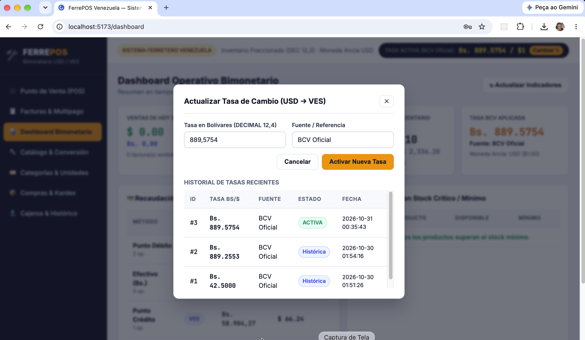
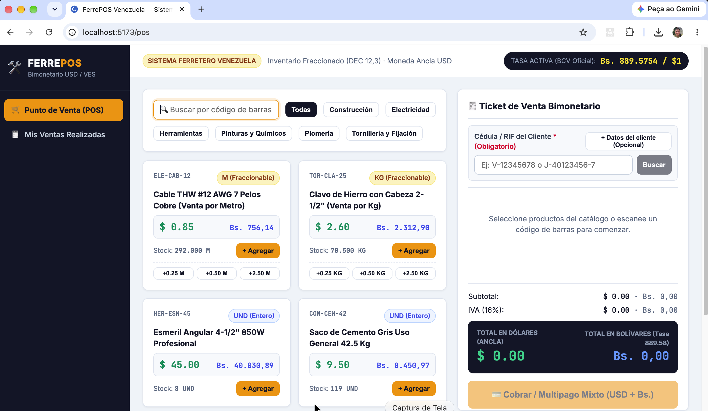
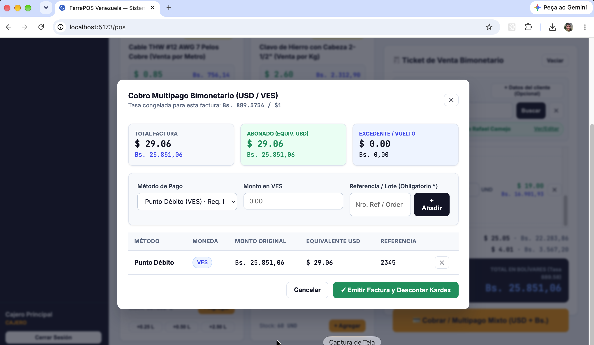
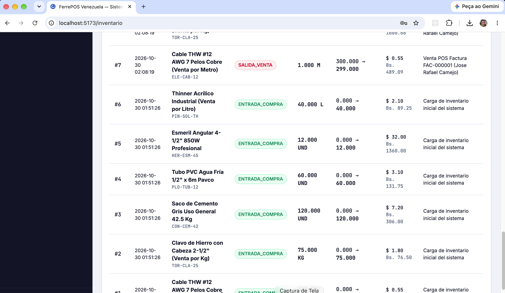
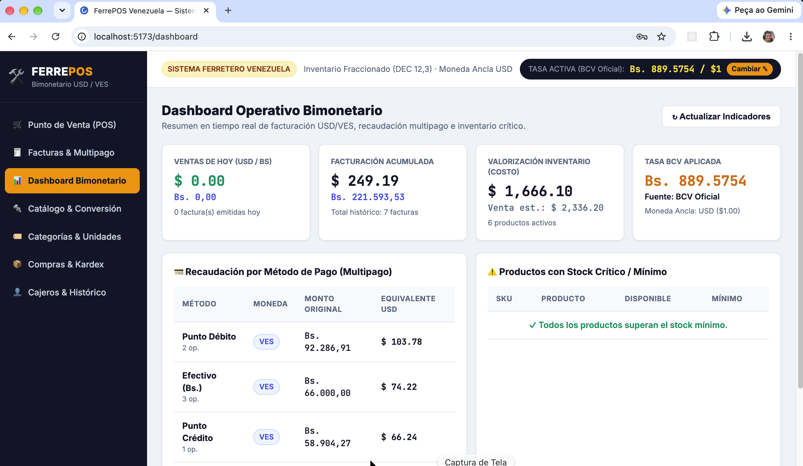

# FerrePOS - Manual de Usuario y Operaciones

Sistema Integral de Punto de Venta (POS), Inventario Fraccionado y Facturación Bimonetaria (USD / VES) diseñado para ferreterías y comercios afines en Venezuela.

---

## Tabla de Contenidos

1. [Introducción y Conceptos Fundamentales](#1-introducción-y-conceptos-fundamentales)
2. [Acceso al Sistema y Roles](#2-acceso-al-sistema-y-roles)
3. [Gestión de la Tasa de Cambio Oficial (USD / VES)](#3-gestión-de-la-tasa-de-cambio-oficial-usd--ves)
4. [Apertura, Arqueo y Cierre de Caja](#4-apertura-arqueo-y-cierre-de-caja)
5. [Punto de Venta (POS) y Venta Fraccionada](#5-punto-de-venta-pos-y-venta-fraccionada)
6. [Cobro y Multipago Mixto (USD / VES)](#6-cobro-y-multipago-mixto-usd--ves)
7. [Gestión de Inventario, Compras y Kardex](#7-gestión-de-inventario-compras-y-kardex)
8. [Dashboard Operativo y Paginación del Catálogo](#8-dashboard-operativo-y-paginación-del-catálogo)
9. [Historial de Facturas y Anulaciones](#9-historial-de-facturas-y-anulaciones)
10. [Preguntas Frecuentes y Solución de Problemas](#10-preguntas-frecuentes-y-solución-de-problemas)

---

## 1. Introducción y Conceptos Fundamentales

FerrePOS está diseñado para responder a las dinámicas del comercio ferretero venezolano:

- **Moneda Ancla (USD)**: Todos los costos, márgenes de ganancia y precios base de venta se estructuran en Dólares Estadounidenses (USD) para proteger el valor de reposición del inventario ante fluctuaciones cambiarias.
- **Facturación Bimonetaria Transparente**: Los precios en Bolívares (VES) se calculan en vivo mediante la Tasa Oficial del Banco Central de Venezuela (BCV). Al momento de emitir una factura, la tasa queda **congelada e inmutable** en el registro fiscal.
- **Inventario Fraccionado de Alta Precisión (`DECIMAL 12,3`)**: Soporte nativo para vender y controlar existencias de productos por metros (cables, mangueras), kilogramos (clavos, alambres, tornillos a granel) o litros (thinner, pinturas, solventes) con 3 decimales de exactitud (ej. `0.250 KG`, `1.500 M`).
- **Kardex Inmutable**: Cada entrada, venta o ajuste genera un registro auditable e irreversible que garantiza la trazabilidad física y contable del almacén.

---

## 2. Acceso al Sistema y Roles

### 2.1. Inicio de Sesión
Ingrese a la dirección web local del sistema (por defecto `http://localhost:5173` o la dirección IP de su servidor de red local) e introduzca sus credenciales de usuario.

### 2.2. Perfiles y Permisos

| Rol | Módulos Accesibles | Responsabilidades Principales |
| :--- | :--- | :--- |
| **ADMIN** (Administrador) | Acceso total: Dashboard, POS, Apertura/Cierre de Caja, Facturación, Catálogo de Productos, Compras/Kardex, Tasas de Cambio, Categorías y Gestión de Cajeros. | Fijar la tasa oficial diaria, registrar compras a proveedores, dar de alta productos, realizar ajustes de inventario, auditar arqueos de caja y anular facturas. |
| **CAJERO** (Operador de Caja) | Apertura/Cierre de Caja, Punto de Venta (POS), Búsqueda Autocomplete de Productos, Emisión de Tickets y Consulta de Facturas Realizadas en su turno. | Abrir su turno con el fondo inicial, atender al cliente en mostrador, despachar artículos fraccionados, registrar pagos mixtos y realizar su arqueo al cierre. |

---

## 3. Gestión de la Tasa de Cambio Oficial (USD / VES)

La tasa de cambio oficial rige la conversión automática de todos los precios visibles en el mostrador y en los tickets.

### 3.1. Consulta de la Tasa Activa
En la barra superior de la aplicación siempre se visualiza la tasa activa en formato:
`TASA ACTIVA (BCV Oficial): Bs. [TASA] / $1`.

### 3.2. Actualizar la Tasa de Cambio Diaria (Rol Administrador)
1. En la barra superior, haga clic en el botón amarillo **Cambiar** o navegue al módulo **Tasas de Cambio**.
2. En la ventana modal:
   - **Tasa Oficial (Bs. por 1 USD)**: Ingrese el valor publicado por el Banco Central de Venezuela (con hasta 4 decimales, ej. `889.5754`).
   - **Fuente / Referencia**: Por defecto "BCV Oficial" o la especificación correspondiente a la fecha.
3. Haga clic en **Guardar y Activar**.
4. Inmediatamente todos los terminales y pantallas del POS actualizarán los precios en Bolívares en tiempo real.
5. El sistema conserva un historial inmutable con fecha, hora exacta y el usuario que realizó la actualización.

> **Importante**: Actualizar la tasa **no altera** las facturas previamente emitidas. Cada factura conserva para siempre la tasa con la que fue procesada.

---

## 4. Apertura, Arqueo y Cierre de Caja

Para garantizar el control financiero de cada turno, **es obligatorio abrir caja antes de emitir facturas** en el Punto de Venta.

### 4.1. Apertura de Caja (Inicio de Turno)
Puede abrir caja desde el menú **🔐 Apertura & Cierre de Caja** (`/caja`) o directamente desde el banner **Apertura Rápida** en la parte superior del POS (`/pos`):
1. Ingrese el **Fondo Inicial Efectivo USD ($)** y el **Fondo Inicial Efectivo Bolívares (Bs.)** disponibles en gaveta para dar vueltos.
2. Opcionalmente agregue una observación (ej. `"Turno mañana - Caja 1"`).
3. Pulse **🔓 Abrir Caja**. El sistema registrará la hora exacta y la tasa de cambio vigente.

### 4.2. Monitoreo en Vivo y Cierre de Caja (Arqueo Bimonetario)
Durante el turno, en `/caja` podrá consultar en tiempo real:
- Cantidad de facturas emitidas y anuladas en el turno.
- Total vendido en USD y Bolívares, más el **desglose por método de pago** (`Efectivo USD`, `Efectivo VES`, `Punto`, `Pago Móvil`, `Zelle`, `Binance`).
- **Efectivo esperado en gaveta**: `Fondo Inicial + Ventas en Efectivo - Vueltos entregados`.

Al finalizar la jornada:
1. Haga clic en **🔒 Realizar Arqueo y Cerrar Caja**.
2. Cuente el dinero físico en gaveta e ingrese **Efectivo Contado USD ($)** y **Efectivo Contado Bolívares (Bs.)**.
3. El sistema calculará en vivo si el arqueo cuadra o si existe diferencia (sobrante/faltante).
4. Confirme el cierre para emitir el **Comprobante de Arqueo** y dejar registro en el historial paginado.

---

## 5. Punto de Venta (POS) y Venta Fraccionada

La interfaz del POS está optimizada para trabajo continuo y ágil en mostrador, permitiendo operaciones con teclado y lector de código de barras sin recargar miles de tarjetas en pantalla.

### 5.1. Buscador Autocomplete y Lector de Código de Barras
- **Búsqueda en tiempo real**: Al escribir el nombre del producto, SKU o código de barras en el buscador superior, se despliegan instantáneamente las coincidencias activas con su **SKU, categoría, stock disponible y precios en USD / Bs.**
- **Atajos de teclado**:
  - `↑` / `↓`: Navegar entre las sugerencias.
  - `Enter`: Agrega inmediatamente el producto resaltado (o el de coincidencia exacta de código de barras/SKU) y limpia el buscador para el siguiente escaneo.
  - `Esc`: Limpia la búsqueda actual.
- **Agregados Recientemente**: Cuando el buscador está vacío, el POS muestra los últimos `6` productos vendidos en la sesión para re-agregarlos con un solo clic.

### 5.2. Venta de Productos Fraccionados
Los productos fraccionables se identifican con la etiqueta de su unidad (`M`, `KG`, `L`):
1. **Atajos Rápidos**: En cada sugerencia del autocomplete dispone de botones rápidos (`+0.25`, `+0.50`, `+2.50`).
2. **Cantidad Personalizada**: Agregue el producto al ticket e introduzca la cantidad exacta con hasta 3 decimales (ejemplo: `1.350 M` de cable o `0.750 KG` de clavos).

### 5.3. Datos del Cliente en el Ticket
1. En el panel lateral derecho (**Ticket de Venta Bimonetario**), introduzca la **Cédula o RIF** del cliente en el campo obligatorio (ejemplo: `V-12345678` o `J-40123456-7`).
2. Haga clic en **Buscar** (o presione `Enter`) para cargar clientes frecuentes o registrar sus datos opcionales.
3. El ticket desglosará automáticamente **Subtotal**, **IVA 16%** y **TOTAL en USD y Bolívares**.

---

## 6. Cobro y Multipago Mixto (USD / VES)

Para adaptarse a la realidad financiera de Venezuela, FerrePOS permite cancelar una misma factura combinando diversos métodos de pago en divisas y moneda nacional.

### 6.1. Flujo de Cobro Paso a Paso
1. En el Ticket de Venta, haga clic en el botón **Cobrar / Multipago Mixto (USD + Bs.)**.
2. Se desplegará la ventana de liquidación con la **tasa congelada** de la transacción.
3. Seleccione el **Método de Pago**:
   - `Efectivo USD`: Pagos en dólares en billete (no requiere referencia).
   - `Efectivo VES`: Pagos en bolívares en efectivo (no requiere referencia).
   - `Punto Débito (VES)`: Tarjetas de débito bancarias (requiere número de aprobación/lote).
   - `Punto Crédito (VES)`: Tarjetas de crédito bancarias (requiere número de aprobación/lote).
   - `Pago Móvil (VES)`: Transferencia interbancaria móvil (requiere últimos dígitos de referencia).
   - `Zelle (USD)`: Transferencia en divisas (requiere nombre o referencia).
   - `Binance Pay (USD)`: Criptoactivos USDT (requiere Order ID).
4. Ingrese el **Monto** en la moneda correspondiente y la **Referencia** (si aplica).
5. Haga clic en **+ Añadir**. El abono se sumará a la lista inferior calculando su equivalente exacto en dólares.
6. **Repita el paso anterior** para abonar otros métodos hasta que el **Total Factura** esté cubierto.

### 6.2. Control de Vueltos y Excedentes
- Si el cliente entrega un monto superior al total (por ejemplo, billete de `$50.00` en una factura de `$29.06`), el sistema calculará en tiempo real el **Excedente / Vuelto** tanto en USD (`$20.94`) como su equivalente en Bolívares.
- Una vez cubierto o superado el total, pulse el botón verde **Emitir Factura y Descontar Kardex**.

---

## 7. Gestión de Inventario, Compras y Kardex

El inventario de FerrePOS opera bajo el principio de **Kardex Inmutable**: ninguna existencia se modifica sin dejar rastro auditable.

### 7.1. Tipos de Movimiento en el Kardex
- `ENTRADA_COMPRA`: Incremento por recepción de mercancía de proveedores.
- `SALIDA_VENTA`: Descuento automático generado inmediatamente al facturar en el POS.
- `ANULACION_VENTA`: Devolución atómica de stock por anulación de factura autorizada.
- `AJUSTE_POSITIVO` / `AJUSTE_NEGATIVO`: Correcciones justificadas por inventario físico o mermas.

### 7.2. Factor de Conversión y Autocompletado en Compras / Ajustes
Muchos productos ferreteros se compran en empaques mayoristas y se venden al detal:
- **Ejemplo**: Se compra un rollo de cable (`ROLLO`) que contiene `100.000` metros.
- Al registrar la compra de `2 ROLLOS`, FerrePOS utiliza el **factor de conversión** (`100.000`) para ingresar automáticamente `200.000 M` al inventario de venta.
- Tanto en el filtro de Kardex como en los modales de **Registrar Compra** y **Ajuste Manual de Stock**, la selección de productos utiliza un buscador **Autocomplete en vivo** por SKU, código de barras o nombre.

### 7.3. Auditoría de Existencias (Paginación)
La tabla de **Kardex** y la de **Entradas de Compra** cuentan con búsqueda en tiempo real y **paginación** (`10 / 25 / 50 / 100` registros por página) para consultar miles de movimientos de forma instantánea.

---

## 8. Dashboard Operativo y Paginación del Catálogo

El Dashboard permite a los administradores y encargados monitorear en tiempo real la salud operativa y financiera del negocio.

### 8.1. Indicadores Principales
1. **Ventas de Hoy**: Total facturado en la jornada expresado en USD y VES, y cantidad de comprobantes emitidos.
2. **Facturación Acumulada**: Histórico de facturación del período.
3. **Valorización del Inventario**: Costo total del inventario disponible y proyección de venta estimada.
4. **Tasa BCV Aplicada**: Tasa que está rigiendo las transacciones actuales (cacheada en **Redis** para respuestas en `< 1 ms`).

### 8.2. Paginación y Caché en Tiempo Real (Redis)
Todos los listados principales (**Productos, Categorías, Kardex, Entradas, Ventas, Cajeros y Cierres de Caja**) utilizan paginación en servidor con selector de registros por página (`10 / 25 / 50 / 100`) y búsqueda instantánea en vivo.
Además, el catálogo de productos, categorías, unidades, métodos de pago y la tasa activa se cachean en **Redis**, invalidándose automáticamente ante cualquier venta, compra o edición.

### 8.3. Monitor de Stock Crítico
Muestra alertas automáticas de productos cuyo stock actual sea igual o menor a su `stock_minimo`, indicando la necesidad de emitir órdenes de compra a proveedores.

---

## 9. Historial de Facturas y Anulaciones

### 9.1. Consulta de Ventas
En el módulo **Facturas & Multipago** (`/ventas`) se pueden consultar todas las ventas emitidas con paginación, filtro por estado (`COMPLETADA` / `ANULADA`) y búsqueda en vivo por número de factura o cliente. Al abrir una factura, se observa el desglose de productos, la tasa congelada en ese instante y los métodos de pago empleados.

### 9.2. Procedimiento de Anulación (Solo Administrador)
1. Localice la factura en el historial.
2. Haga clic en **Anular**.
3. Indique el motivo de la anulación (devolución del cliente, error de carga, etc.).
4. Al confirmar, el sistema ejecuta una transacción atómica:
   - Marca la factura como `ANULADA`.
   - Genera automáticamente un movimiento `ANULACION_VENTA` en el Kardex devolviendo cada artículo y fracción al inventario disponible.
   - Ajusta los reportes de recaudación, ventas netas y arqueo de caja.

---

## 10. Preguntas Frecuentes y Solución de Problemas

### ¿Por qué el POS indica "Caja Cerrada" al intentar facturar?
Por control de arqueo, cada cajero debe abrir su turno antes de emitir facturas. Puede hacerlo ingresando su fondo inicial en USD/Bs. directamente en el banner superior de `/pos` o en el módulo **🔐 Apertura & Cierre de Caja** (`/caja`).

### ¿Qué sucede si la tasa del BCV cambia a mitad de la tarde?
El administrador debe actualizar la tasa en el módulo de Tasas. A partir de ese segundo, todas las nuevas cotizaciones y tickets del POS adoptarán la nueva tasa. Las facturas ya emitidas en la mañana no sufrirán ninguna modificación, protegiendo la integridad contable.

### ¿Cómo registrar la venta de 1/2 kilo de clavos o 3/4 de metro de manguera?
En el catálogo del POS, pulse el producto y en el campo de cantidad ingrese `0.500` (para 1/2 kilo) o `0.750` (para 3/4 de metro). El sistema calculará el precio exacto proporcional a la fracción.

### ¿Un cliente puede pagar una parte con tarjeta de débito y otra con un billete de $20?
Sí. En el modal de Cobro Multipago, ingrese primero el abono en Dólares (`$20.00` en `Efectivo USD`) y luego ingrese el monto restante por `Punto Débito` con su respectivo número de referencia.

### ¿Dónde verificar el inventario de un producto con dudas de existencia?
Consulte el módulo **Kardex** filtrando por el producto deseado. Podrá ver línea por línea cada factura donde salió mercancía y cada compra donde ingresó, con la fecha y el usuario responsable.

---

*FerrePOS — Sistema Ferretero Bimonetario de Venezuela.*

